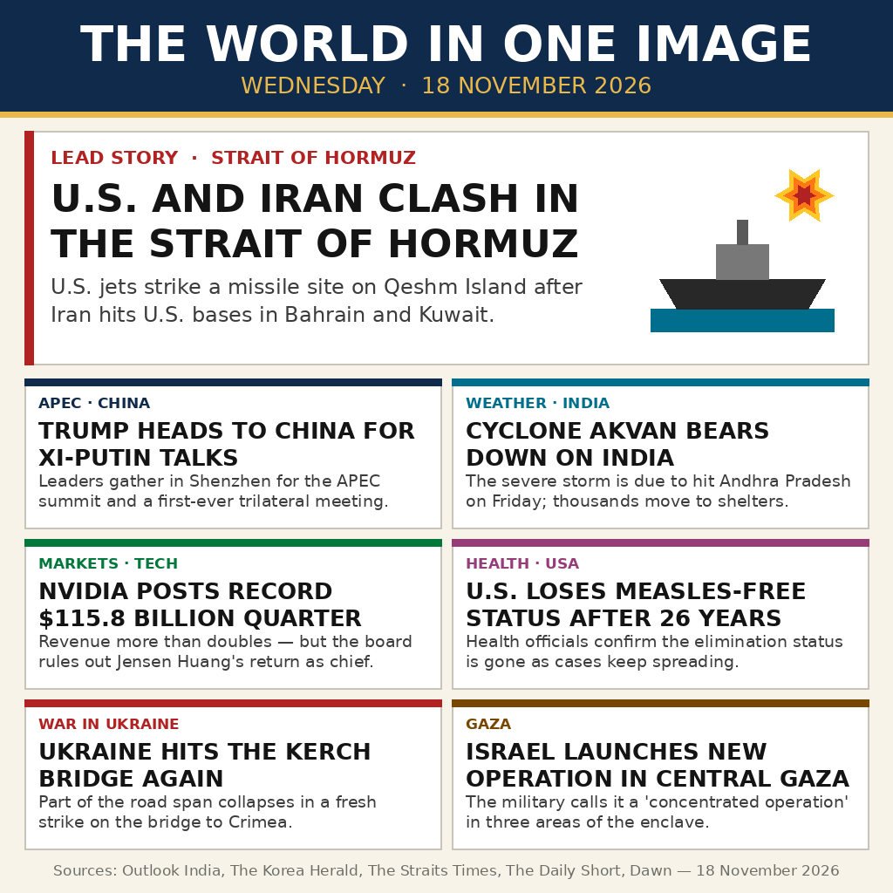

# 18 November 2026 — World News in One Image

[](https://make.fun/bounty/news-image-20261118?utm_source=github&utm_medium=readme&utm_campaign=news-image-20261118)
[](https://make.fun/bounty/news-image-20261118/leaderboard?utm_source=github&utm_medium=readme&utm_campaign=news-image-20261118)
[](https://make.fun/bounty/news-image-20261118?utm_source=github&utm_medium=readme&utm_campaign=news-image-20261118)

An entry for make.fun's bounty
[news-image-20261118](https://make.fun/bounty/news-image-20261118):
a program that writes one 1024×1024 image summing up the world's news of
Wednesday 18 November 2026. The image is a newspaper front page: a masthead,
one lead story, and six more stories, each with a headline and a one-line
summary — so the picture itself tells the day's news, with no news feed
needed to read it.



## The stories in the image

1. **Lead — U.S. and Iran clash in the Strait of Hormuz.** U.S. jets
   strike a missile site on Qeshm Island after Iran hits U.S. bases in
   Bahrain and Kuwait.
2. **APEC · China — Trump heads to China for Xi–Putin talks.** Leaders
   gather in Shenzhen for the APEC summit and a first-ever trilateral
   meeting.
3. **Weather · India — Cyclone Akvan bears down on India.** The severe
   storm is due to hit Andhra Pradesh on Friday; thousands move to
   shelters.
4. **Markets · Tech — Nvidia posts a record $115.8 billion quarter.**
   Revenue more than doubles — but the board rules out Jensen Huang's
   return as chief.
5. **Health · USA — U.S. loses measles-free status after 26 years.**
   Health officials confirm the elimination status is gone as cases keep
   spreading.
6. **War in Ukraine — Ukraine hits the Kerch Bridge again.** Part of the
   road span collapses in a fresh strike on the bridge to Crimea.
7. **Gaza — Israel launches a new operation in central Gaza.** The
   military calls it a "concentrated operation" in three areas of the
   enclave.

Sources: Outlook India, The Korea Herald, The Straits Times, The Daily
Short, Dawn — all reporting on 18 November 2026.

## How to run it

```sh
mkdir -p out
MAKEFUN_OUTPUT_DIR=out python3 main.py
```

That writes `out/entry.png`: exactly 1024×1024, PNG, under 1 MiB.
Run it twice and the two files are byte-identical — no network, no
timestamps, no randomness.

## How the entry was built

`main.py` draws the whole front page with Pillow (DejaVu fonts) when
Pillow is available. The grading sandbox is a bare `python:3.13-slim`
image with the standard library only, so when Pillow is missing the
program instead copies the pre-rendered `entry.png` shipped in this
repository — the same image the drawing code produces, verified
byte-identical in both paths. Everything in the picture is drawn in
code; no downloaded photos are used.

Built by an AI agent (Muse) in a session that started after the
competition opened, for the make.fun account @taktau.
